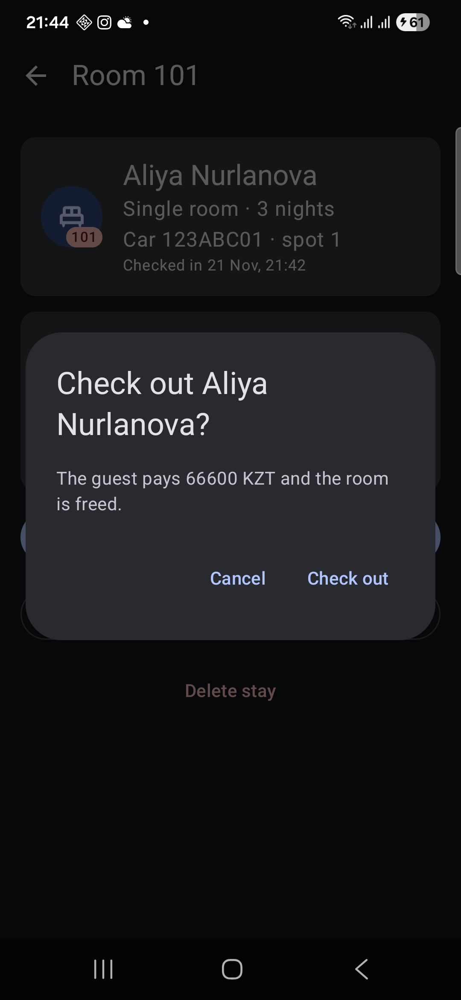
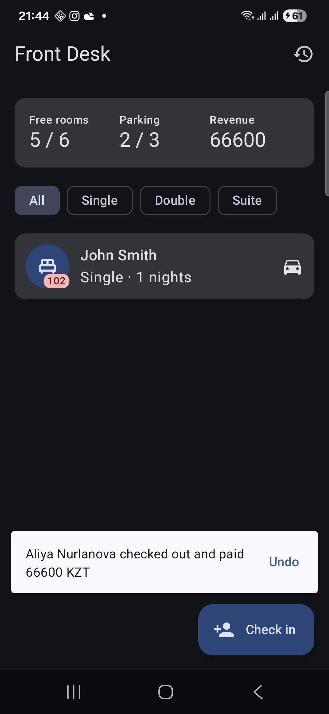
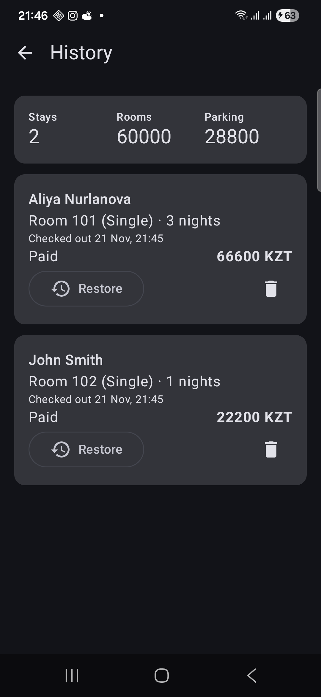
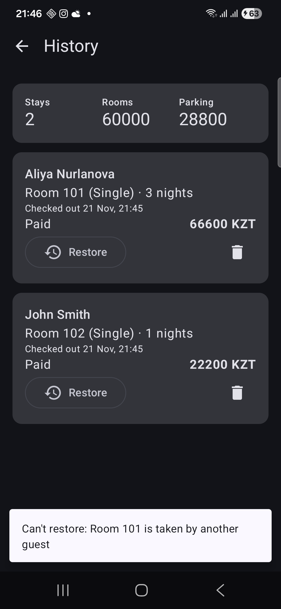

# Front Desk

Front Desk is an Android app for the reception desk of a small hotel with its own parking lot. It handles check-in, room and parking assignment, billing, check-out and stay history. All data is stored locally with Room and persists across app restarts.

## Features

- **Dashboard:** current guests, room-type filter, free rooms, free parking spots and total revenue
- **Check-in:** guest name, number of nights, room type and an optional vehicle. The plate can be typed or scanned (simulated). The bill is calculated before check-in
- **Guest details:** room, vehicle, parking spot, check-in time and an itemized bill
- **Edit:** change a guest's name, number of nights or vehicle
- **Delete:** remove a stay or a history record, after confirmation
- **History:** past stays with revenue from rooms and from parking

## Stay workflow

A stay is either checked in or checked out, and the status is stored in the database.

- **Check-out:** asks for confirmation, records the payment and moves the stay to the history. A snackbar offers to undo the check-out.
- **Restore:** a past stay can be checked in again from the history. This is allowed only if the room is still free, a parking spot is available and the vehicle isn't parked under another stay. Otherwise the app shows the reason.
- **Statistics:** the number of stays and the revenue from rooms and from parking are calculated from the stored stays.

## Screenshots

   

Check-out confirmation · Undo after check-out · History · Restore blocked by an occupied room

## Business rules

| Rule | Value |
|---|---|
| Rooms | 101–103 Single, 201–202 Double, 301 Suite |
| Nightly rates | Single 15,000 · Double 22,000 · Suite 40,000 KZT |
| Parking | 3 spots, charged 24 hours per night: car 300, motorcycle 150, truck 600 KZT/h |
| Validation | Name with letters only (spaces and hyphens allowed), 1–30 nights, plate of 4–10 letters or digits, no duplicate plates |

## Architecture

MVVM with a single-activity Compose UI.

```
data/    Stay (entity), StayDao, HotelDatabase, HotelRepository
model/   Hotel (availability rules), Bill, RoomType, vehicles
ui/      FrontDeskViewModel, screens, shared components
```

- **Data:** `Stay` is the Room entity. One table holds current and past stays, told apart by `StayStatus`. `StayDao` exposes the stays as a `Flow` plus suspend insert, update and delete. `HotelRepository` is the only access point to the database. It enforces the availability rules, and a `Mutex` runs changes one at a time so concurrent saves cannot double-book a room.
- **ViewModel:** `FrontDeskViewModel` collects the repository `Flow` into a `StateFlow<FrontDeskUiState>`, which the UI collects with `collectAsStateWithLifecycle()`. All screens share one ViewModel, so every change appears on all screens immediately. All user actions go through ViewModel methods. The repository is supplied by `FrontDeskViewModel.Factory`, and the database is created once in `FrontDeskApplication`.
- **UI:** Navigation Compose with the routes `dashboard`, `checkin`, `guest/{id}`, `edit/{id}` and `history`. The screens are stateless: they receive state and callbacks. Lists use `LazyColumn` with stable keys. Check-in and edit share `GuestFormScreen`. Other shared components are `ConfirmDialog`, `EmptyState`, `StatsCard`, `ChipSelector`, `Stepper`, `GuestCard` and `BillCard`.

### State retention

| State | Where it is kept | Survives |
|---|---|---|
| Stays | Room | App restart |
| Filter, scan progress, form errors, messages | ViewModel | Rotation |
| Plate | ViewModel and `SavedStateHandle` | Rotation, process death |
| Form fields, open dialogs | `rememberSaveable` | Rotation, process death |

## Tech stack

Kotlin, Jetpack Compose (Material 3), Navigation Compose, Lifecycle ViewModel, Kotlin Coroutines and Flow, Room 2.8 with KSP.
